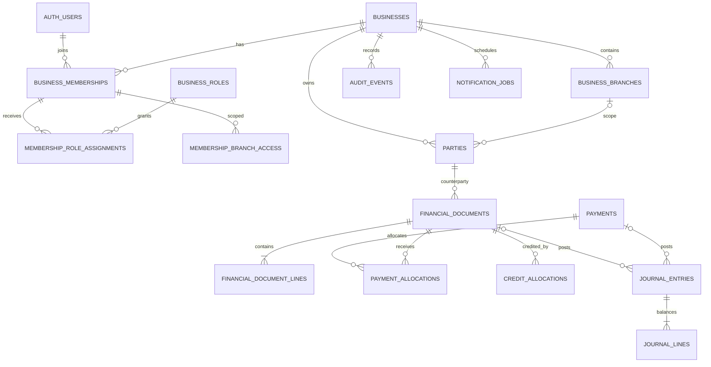

# SaaS database design proposal

**Status:** Logical design, not executable migration SQL. No database changes were made. Names/types may be adjusted after a clean schema diff against the live project.

## Design rules

1. Every tenant-owned row has `business_id uuid not null`. This includes parent and child ledger records, branches, memberships, role rows, user preferences, audit events, outbox items and notification data. Global plan/permission catalogs and Supabase Auth identities are platform-scoped exceptions.
2. Where applicable, every branch-owned row has nullable `branch_id` plus a composite FK `(business_id, branch_id) -> business_branches(business_id,id)`. Null means business-wide/head-office.
3. Every tenant parent has `unique (business_id,id)`, and child rows use composite FKs such as `(business_id,party_id) -> parties(business_id,id)`. This prevents linking a row to another tenant even if an ID is guessed.
4. Amounts use exact `numeric`, with explicit currency and scale policy. No authoritative user-editable balance columns.
5. Posted financial facts and audit history are append-only. RLS, grants and controlled posting/reversal functions enforce this; frontend restrictions do not.
6. Keep Auth users in `auth.users`; business membership is a separate many-to-many relationship. A person can belong to multiple businesses and have different roles in each.

## Entity map



`AUTH_USERS` is Supabase Auth; the remaining boxes represent proposed application entities.

## Core tenant, membership, roles and branch tables

| Table | Key columns | Constraints/behavior |
|---|---|---|
| `businesses` | `id`, `name`, `slug`, `status`, `timezone`, `default_currency`, `created_by`, timestamps | Unique normalized slug; status lifecycle; creator references Auth. Business itself is the tenant root. |
| `business_memberships` | `business_id`, `user_id`, `status`, `invited_by`, invite/join/removed timestamps | PK `(business_id,user_id)`; business FK cascade only for controlled business closure; user FK to Auth; active/invited/suspended/removed status. Never store an Auth password. |
| `business_branches` | `business_id`, `id`, `code`, `name`, address, timezone, `is_active` | PK `id`, unique `(business_id,id)`, unique `(business_id,code)`; every branch belongs to one business. |
| `permissions` | `permission_key`, description | Global, fixed catalog, seeded by migrations; not customer-editable. Examples below. |
| `business_roles` | `business_id`, `id`, `name`, `is_system`, timestamps | PK `id`; unique `(business_id,id)` and `(business_id,name)`; system roles protected from deletion/unsafe edits. |
| `role_permissions` | `business_id`, `role_id`, `permission_key` | Composite PK; composite role FK; permission FK. |
| `membership_role_assignments` | `business_id`, `user_id`, `role_id` | Composite PK; FKs ensure role and membership share business. Support multiple roles by union of allowed permissions, with deny/sensitive override policy explicitly defined. Simpler first release may constrain one role per membership. |
| `membership_branch_access` | `business_id`, `user_id`, `branch_id` | PK `(business_id,user_id,branch_id)`; only necessary for branch-limited members. Store all-branches access on membership, and enforce it in a helper to avoid ambiguous empty-list semantics. |

An owner is a business-scoped role assignment with protected owner capabilities, not a singleton platform account. Platform support identities and grants are separate from tenant memberships.

## Parties and financial tables

### Parties

`parties(business_id, id, party_type, name, company_name, contact, location, notes, status, created_at, updated_at)`

- `party_type` is customer, supplier, or both. A party record is always business-scoped; businesses never share one party row.
- `unique (business_id,id)` supports composite FKs. Name/contact indexes are tenant-prefixed; decide whether business-specific normalized-name uniqueness is desirable after migration data is profiled.
- Archive instead of hard delete once referenced by a document or payment. Never cascade financial history away when removing a party.

### Documents and lines

`financial_documents(business_id, id, branch_id, party_id, document_type, fiscal_period, document_number, status, currency_code, issue_date, due_date, memo, created_by, posted_at, reversed_by, source_legacy_id, created_at)`

- `document_type`: `sale_invoice`, `purchase_bill`, `sales_credit`, `purchase_debit`, and controlled opening-balance types.
- `status`: draft, posted, void/reversed. Only posting functions can transition drafts to posted; a posted document is not edited in place.
- Composite FKs enforce same-business party, branch and reverse relationship. Unique document number is scoped to business, branch scope and fiscal period according to the approved numbering policy. Since nullable branch columns do not collide under ordinary PostgreSQL UNIQUE semantics, use separate partial unique indexes (branch-wide and business-wide) or a normalized numbering-scope key.
- `financial_document_lines(business_id,id,document_id,line_number,description,quantity,unit,unit_price,tax_code,net_amount,tax_amount,account_id)` carries source detail. Validate `quantity >= 0`, price/amount rules and currency rounding. Store posted values as immutable snapshots even if product/tax descriptions later change.
- Header totals are calculated from lines at posting. If stored as a snapshot for performance/immutability, a posting function verifies equality against line totals; it is not independently editable.

### Payments and allocations

`payments(business_id,id,branch_id,party_id,payment_direction,amount,currency_code,paid_at,payment_method,reference,status,created_by,posted_at,source_legacy_id)`

- `payment_direction` distinguishes money received from a customer and money paid to a supplier. Check positive amount and valid party type/direction.
- A payment may be unallocated (customer credit or supplier advance) or allocated across multiple open documents.
- `payment_allocations(business_id,id,payment_id,document_id,amount,created_at,created_by)` uses same-business composite FKs. Enforce party and currency consistency and total allocations `<= payment amount` under a row lock in an atomic allocation function. A cross-row aggregate cannot be guaranteed by a simple CHECK constraint.
- `credit_allocations` (or a similarly explicit table) links a posted credit/debit document to target documents. Avoid a polymorphic `source_type/source_id` FK with no database referential integrity.
- Allocation/unallocation after posting is represented by immutable allocation and reversal records, not destructive edits. Define whether cash refunds are separate payments.

### Double-entry journal

`ledger_accounts(business_id,id,account_code,name,account_type,control_type,is_active)` and `journal_entries(business_id,id,branch_id,entry_number,source_type,source_id,currency_code,posting_date,status,reversal_of,created_by,posted_at)` plus `journal_lines(business_id,id,journal_entry_id,line_number,account_id,party_id,debit,credit,currency_code,description)`.

- A posting function writes all journal rows atomically and requires total debits equal total credits per entry and currency. Enforce at posting boundary using a deferred constraint trigger or a single trusted function; normal CHECK cannot sum sibling rows.
- Each line has exactly one positive side (`debit > 0 XOR credit > 0`); amounts are rounded to the configured currency scale. Composite FKs ensure account, party, branch and entry all share a business.
- Receivables/payables control-account lines require a party. Example postings: customer sale = Dr AR / Cr Sales; supplier bill = Dr Purchases or Inventory / Cr AP; receipt = Dr Cash / Cr AR; supplier payout = Dr AP / Cr Cash.
- One journal entry per posted source is enforced with unique `(business_id, source_type, source_id)` or an equivalent source FK design. Posting functions use idempotency keys for retry safety.
- Posted journal entries and lines cannot be updated/deleted through client grants or RLS. Corrections post reversing entries linked with `reversal_of`; preserve the original.
- Party balances derive from AR/AP control-account journal lines and settlement allocations. An optional balance projection is rebuildable and compared with those rows; it is not authoritative.

### Audit and attribution

`audit_events(business_id,id,branch_id,actor_user_id,action,entity_type,entity_id,occurred_at,request_id,metadata)` records successful sensitive actions and financial lifecycle changes. Financial rows carry `created_by`/`posted_by`; audit data should note source IDs and reversal links. Protect rows as append-only and prevent clients from writing arbitrary actor IDs or metadata. Redact passwords, access tokens, payment secrets and unnecessary PII.

## Subscription and configuration tables

- `plans(plan_key,version,display_name,is_active)` and `plan_entitlements(plan_key,version,entitlement_key,limit_value,enabled)` are platform catalogs. Keep billing provider products mapped through private identifiers, never card data.
- `business_subscriptions(business_id,id,plan_key,provider,provider_customer_id,provider_subscription_id,status,period_start,period_end,grace_until,canceled_at)` is business-owned. Unique provider subscription ID and idempotent webhook event storage prevent duplicate transitions.
- Usage counters can be maintained as metering projections but must be reconciled with source rows and enforced inside server write functions.
- Business locale/timezone/currency and notification defaults are tenant-scoped settings. Secret provider tokens belong in Edge Function secrets or a managed vault, not client-readable tables.

## Indexes and constraints

Apply indexes to actual query/policy shapes and check `EXPLAIN` against production-like volumes. Starting candidates:

- `business_memberships(user_id,status,business_id)` and `(business_id,status,user_id)`.
- `membership_role_assignments(business_id,user_id)`; branch grant `(business_id,user_id,branch_id)`.
- Every tenant-owned parent `unique(business_id,id)` plus composite FKs. Ensure FK referencing columns are indexed where PostgreSQL does not create the referencing-side index.
- `parties(business_id,party_type,status,name)`; optional trigram/full-text search per business after search behavior is decided.
- `financial_documents(business_id,branch_id,party_id,issue_date desc,id)`, and partial due/open index `(business_id,branch_id,due_date)` where status is posted and outstanding remains.
- `payments(business_id,branch_id,party_id,paid_at desc,id)`; `payment_allocations(business_id,document_id)` and `(business_id,payment_id)`.
- `journal_entries(business_id,branch_id,posting_date,id)` and unique source key; `journal_lines(business_id,account_id,party_id,journal_entry_id)`.
- `audit_events(business_id,occurred_at desc,id)` and entity lookup `(business_id,entity_type,entity_id,occurred_at)`.
- Foreign-key and uniqueness constraints always include `business_id` for tenant-to-tenant relationships. Soft delete does not remove a unique-key conflict unless partial uniqueness is specifically intended.

## RLS policy pattern

This is illustrative policy logic, **not migration SQL**:

```sql
-- Policies apply to authenticated users. The helper checks auth.uid() against
-- active membership, the permission catalog and branch grants in the DB.
create policy documents_read on public.financial_documents
  for select to authenticated
  using (private.member_can(business_id, branch_id, 'ledger.read'));

create policy documents_insert on public.financial_documents
  for insert to authenticated
  with check (private.member_can(business_id, branch_id, 'documents.create')
              and created_by = (select auth.uid()));

create policy documents_update_drafts on public.financial_documents
  for update to authenticated
  using (status = 'draft'
         and private.member_can(business_id, branch_id, 'documents.edit_draft'))
  with check (status = 'draft'
              and private.member_can(business_id, branch_id, 'documents.edit_draft'));
```

`private.member_can` is a carefully audited database helper, not a client-settable GUC or trusted `business_id` claim. If implemented as `SECURITY DEFINER` to avoid membership-table RLS recursion, use a fixed empty search path, schema-qualified objects, `auth.uid()` as caller, minimal grants and a non-exposed schema. Never grant clients access to `service_role`. Every tenant table needs operation-appropriate policies or deliberately no client policy. Internal posting functions authorize permission and target business before using privileged writes.

## RLS coverage checklist

RLS/grants must cover businesses, branches, memberships, roles/assignments, parties, documents/lines, payments/allocations, chart/journal entries/lines, audit events, business settings, notification preferences/consent/schedules/jobs/deliveries, subscriptions/entitlements, import batches, and Storage object metadata. Platform catalogs can be globally readable only when they contain no secrets or tenant data. Test cross-tenant parent IDs and branch IDs as well as direct table access and every RPC.
