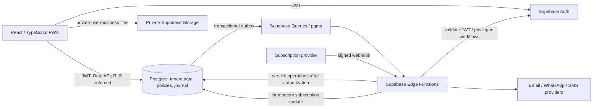

# Target architecture: RKH Ledger SaaS

**Status:** Design proposal only. No application or database changes were made. Review these decisions before implementation.

## Architecture decisions

1. **Keep the React/Vite PWA and Supabase.** Continue using React/TypeScript for the browser app, Supabase Auth for identities, Postgres as the financial source of truth, RLS for data access, Storage for private user/business files, and Deno Edge Functions for trusted integrations. The existing Express health API remains operational plumbing unless a concrete product API need emerges; do not route ledger access through a second backend without a reason.
2. **Make the business the tenant.** A `businesses` row owns ledger data and configuration. One Auth user can hold memberships in several businesses. Business selection is an application context for queries and navigation, not a security claim supplied by the browser.
3. **Make membership and roles business-scoped.** Each membership grants one or more business roles; permissions resolve in the database. Platform support is separate from business ownership and uses audited, time-limited support access.
4. **Add branches as an optional child scope from the start.** Keep `business_id` on every owned record and add nullable `branch_id` for records that belong to a branch. An unassigned record is business-wide/head-office. Branch access is explicitly granted; business owners/admins may have all-branch scope. This permits branch reporting while retaining business-wide consolidated reports.
5. **Use a posted subledger and immutable journal as the financial source of truth.** Draft documents can change; posted documents and journal entries are corrected by reversal/credit/debit entries. Allocations connect partial payments to documents. Balances are derived from journal/subledger activity; no editable balance column drives accounting.
6. **Treat plans as server-enforced entitlements.** Keep plan definitions, business subscriptions, entitlements and provider webhooks in the database. UI feature flags are presentation only; write paths enforce subscription state and usage limits server-side.
7. **Use an outbox and durable queue for outbound communication.** A ledger commit records an outbox event transactionally; a scheduler creates due reminder jobs; workers deliver through channel adapters; delivery rows retain provider outcomes and retry state. Messaging failure never rolls back a posted ledger transaction.

## System context

## Tenant and branch scopes

- **Business:** legal/commercial account, billing customer, locale/time zone, default currency and lifecycle state.
- **Branch:** optional business unit with its own name/code, address and active state. Branch rows always belong to one business.
- **Membership:** Auth user to business link, status, invitation/joined timestamps, and role assignments. Branch scope is all branches or an explicit allow-list.
- **Owned records:** Parties, documents, payments, allocations, journal data, preferences, notification jobs, audit rows, files, and most business settings carry `business_id`. Records naturally specific to a branch also carry `branch_id`.
- **Selection:** Current business/branch is stored in frontend state or a safe profile preference for convenience. Every request still specifies or filters the resource scope, and Postgres verifies live membership and branch grants. A forged browser parameter must return no unauthorized rows and must not permit writes.

## Authentication and authorization flow

1. Supabase Auth authenticates a person and issues a JWT. Do not put mutable business roles in user-editable metadata or rely on stale JWT claims for membership authorization.
2. The browser selects a business and optionally a branch. React hides unavailable navigation and supplies filters, but those checks are only UX.
3. Postgres RLS validates `auth.uid()` against active `business_memberships`, then validates branch access and the required permission for each operation. Business IDs on related rows must agree through composite FKs.
4. Sensitive actions (inviting/removing members, changing roles, posting/reversing financial activity, billing webhooks, external provider calls) run through narrowly scoped SQL functions or Edge Functions. Functions derive the caller from a validated JWT; service-role paths perform explicit membership/permission checks because service role bypasses RLS.
5. Platform support access is a separate, audited, expiring grant with a reason/ticket reference; no hidden global superuser access from ordinary business roles.

For Supabase, use enabled RLS on every exposed tenant table, restrictive grants, predictable policy helpers and indexes on policy columns. Supabase's current RLS guidance covers these patterns; its performance guide recommends evaluating policy query shape and indexes. Links: [RLS](https://supabase.com/docs/guides/database/postgres/row-level-security), [RLS performance](https://supabase.com/docs/guides/database/postgres/row-level-security-performance).

## Financial and reporting architecture

- Record sales/purchases as documents with lines, invoice date, due date, reference/number and currency.
- Record each cash/bank receipt or payment as a payment event, with method/reference and posted date.
- Allocate payments to one or more documents, with partial and over-payment support. An unallocated amount is a customer credit or supplier advance and remains visible as such.
- On posting, a database transaction validates the document, creates a balanced journal entry and audit event, updates neither a manually editable balance nor a cached authoritative total, and emits an outbox event.
- A posting operation is idempotent. Posted rows are immutable; corrections use reversal and replacement entries. Drafts can be edited/deleted under permissions.
- Reports query journal/subledger facts by business, branch, date, account and party. Read-optimized summaries may be added later, but are rebuildable caches with reconciliation to the journal.
- Money uses exact PostgreSQL `numeric`, explicit ISO currency code, and currency-specific scale/rounding. Never calculate financial totals with JavaScript binary floating point as the source of truth; use integer minor units at UI boundaries or decimal-safe serialization.

## Subscription and metering architecture

- A business may have a subscription state (`trialing`, `active`, `past_due`, `grace`, `suspended`, `canceled`) and provider customer/subscription identifiers.
- Plan rows define limits/features; business entitlements record effective values and effective dates. Webhook event IDs are unique and processed idempotently.
- Enforce member/branch/record/storage limits on server-side create paths. Decide grace behavior explicitly: financial reads/exports remain available; new writes may be restricted only after a communicated grace period.
- Do not store card numbers or provider secrets in app tables. Keep credentials in Supabase Edge Function secrets or a managed secret store.

## Operational boundaries

- **Confirmed from audit:** The current worker functions, push, private avatar storage and Vercel-hosted PWA provide useful reuse points.
- **Recommendation:** Add staging/preview Supabase projects, migration checks, RLS test users for multiple businesses/branches, backups and restore drills, observability, rate limits, secret rotation and data export/delete runbooks before onboarding external tenants.
- **Recommendation:** Keep PWA offline behavior online-only initially. If later introduced, encrypt cached data, bind it to a user/business, expire it on logout or membership change, and define conflict resolution.

## Review decisions required before implementation

- Whether the ledger remains party-level only, or commits to invoices, line items, taxes and payment allocation in the first commercial release.
- Currency and localization policy; whether first release is NPR-only while storing an explicit currency code.
- Branch meaning, branch-wide numbering, branch-level access and consolidation rules.
- Which users can invite employees and whether invitation is email-link or admin-set temporary credential.
- Grace period and read-only behavior for unpaid subscriptions.
- Retention, account closure, export, support access and audit-event retention policy.

## Current Supabase references

The design uses standard Postgres RLS and Edge Functions, and recommends Supabase Queues (Postgres-backed `pgmq`) plus scheduled consumers for durable asynchronous work. Queue consumption can be exactly-once within its visibility semantics; a third-party send is still an external side effect and must use idempotency/deduplication and recorded outcomes. References: [Supabase Queues](https://supabase.com/docs/guides/queues), [Queues quickstart](https://supabase.com/docs/guides/queues/quickstart), [Edge Function background tasks](https://supabase.com/docs/guides/functions/background-tasks), [Edge Function secrets](https://supabase.com/docs/guides/functions/secrets). Reviewed 2026-11-07; the Supabase changelog was checked for recent breaking changes relevant to the proposed JS/Postgres approach, and none were identified.
